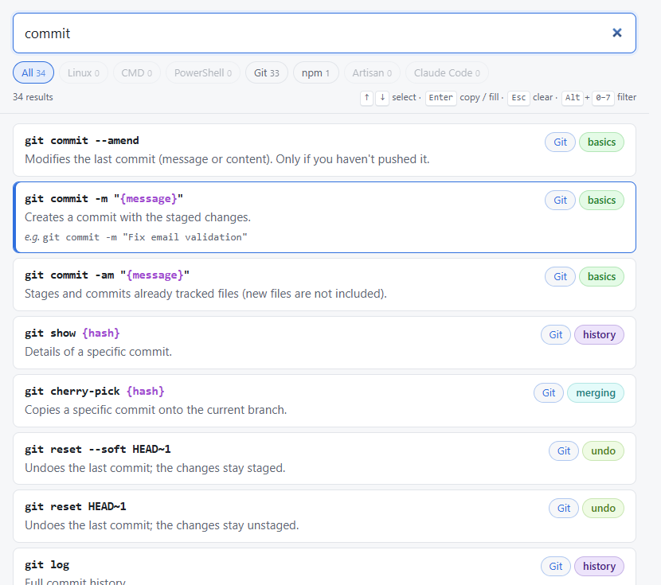
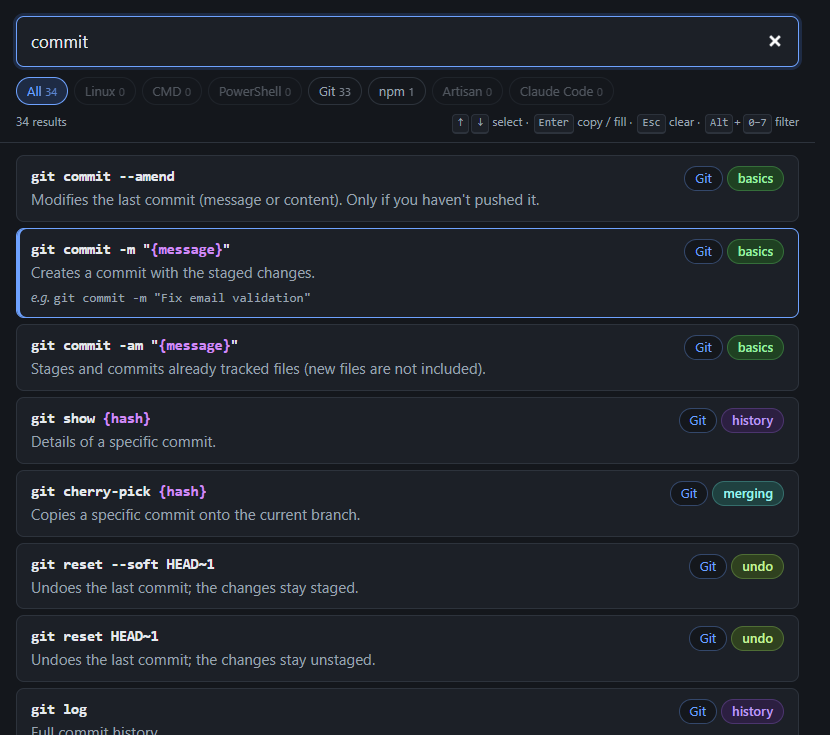

# Cheatsheet

A personal, offline-first PWA to find and copy developer commands in a couple of keystrokes. No backend: the commands live in YAML files in this repo and are bundled into the app.

The command descriptions are in Spanish; the UI and code are in English.

| Light | Dark |
|---|---|
|  |  |

## Features

- **Fuzzy search** over command, description, tags and category, with typo tolerance and accents ignored. Multi-word queries match every word in any order (`crear rama` = `rama crear`).
- **Tool filter** with live match counts per tool.
- **Copy** with a click, or with <kbd>Enter</kbd> on the selected result.
- **Keyboard first**: the whole app works without a mouse (see [shortcuts](#keyboard-shortcuts)).
- **Light / dark** theme following the system.
- **Installable PWA** that works fully offline, with no server running.

## Commands included

| Tool | Entries |
|---|---|
| Linux (bash) | 84 |
| Windows CMD | 74 |
| PowerShell | 67 |
| Git | 101 |
| npm | 41 |
| Laravel Artisan | 103 |
| Claude Code (CLI, flags, slash commands, shortcuts) | 72 |

Variable parts are shown as `{placeholders}`, e.g. `git switch -c {rama}`.

## Getting started

Requires Node.js 20+.

```bash
npm install
npm run dev        # http://localhost:5173
```

### Install as an app

```bash
npm run build && npm run preview   # http://localhost:4173
```

Open `http://localhost:4173` in Chrome or Edge and click the install icon in the address bar. After that you can stop the server: the installed app runs offline.

To update the installed app after changing commands or code, run `npm run build && npm run preview` again, open the app once (it updates on load) and stop the server. Keep port 4173: the installed app is bound to that address.

## Keyboard shortcuts

| Keys | Action |
|---|---|
| <kbd>Ctrl</kbd>+<kbd>K</kbd> or <kbd>/</kbd> | Focus the search box |
| <kbd>↑</kbd> <kbd>↓</kbd> | Move the selection (<kbd>PgUp</kbd> / <kbd>PgDn</kbd> jump 10) |
| <kbd>Enter</kbd> | Copy the selected command |
| <kbd>Esc</kbd> | Clear the search, then the tool filter |
| <kbd>Alt</kbd>+<kbd>0</kbd>…<kbd>7</kbd> | Filter by tool (0 = all) |
| Any character | Typing anywhere goes into the search box |

## Adding or editing commands

The YAML files in [`data/`](data/) are the single source of truth, one file per tool:

```yaml
- tool: git                      # must match the file name (data/git.yaml)
  category: ramas
  command: 'git switch -c {rama}'
  description: Crea una rama nueva y cambia a ella.
  tags: [branch, crear]          # optional
  example: 'git switch -c feature/login'   # optional, concrete values
```

Then run:

```bash
npm run build-data
```

It converts the YAML into `src/generated/commands.json` and fails with a clear message on missing fields, unknown fields, a `tool` that doesn't match the file name, duplicates, malformed placeholders (`<url>`, `{Rama}`) or placeholders inside `example`. `dev` and `build` run it automatically.

To add a new tool, create `data/<tool>.yaml` and add it to [`src/tools.js`](src/tools.js) (label and order).

See [`CLAUDE.md`](CLAUDE.md) for the full data conventions.

## Scripts

| Script | What it does |
|---|---|
| `npm run dev` | Dev server with hot reload (no service worker) |
| `npm run build` | Production build into `dist/` |
| `npm run preview` | Serve `dist/` on port 4173 (service worker, offline, install) |
| `npm run build-data` | Validate `data/*.yaml` and generate the JSON |
| `npm run generate-icons` | Regenerate the PNG icons from `public/favicon.svg` |

## Project structure

```
data/              Command data, one YAML per tool (source of truth)
scripts/           build-data.js
src/
  main.js          Wiring: data, state, events
  state.js         Single app state
  search.js        Fuse.js search + re-ranking
  render.js        DOM rendering
  keyboard.js      Keyboard shortcuts
  clipboard.js     Copy with fallback
  tools.js         Tool labels and order
  styles.css
public/            Icon source (favicon.svg) and generated icons
```

## Tech stack

[Vite](https://vite.dev) · vanilla JavaScript · [Fuse.js](https://www.fusejs.io) · [js-yaml](https://github.com/nodeca/js-yaml) · [vite-plugin-pwa](https://vite-pwa-org.netlify.app) (Workbox)

## Roadmap

Not implemented yet. Each command already has a stable `id` and a parsed list of `placeholders` to support these:

- Favorites and recently copied commands
- A form to fill in placeholders before copying
- Editing commands from the app

## License

[MIT](LICENSE)
